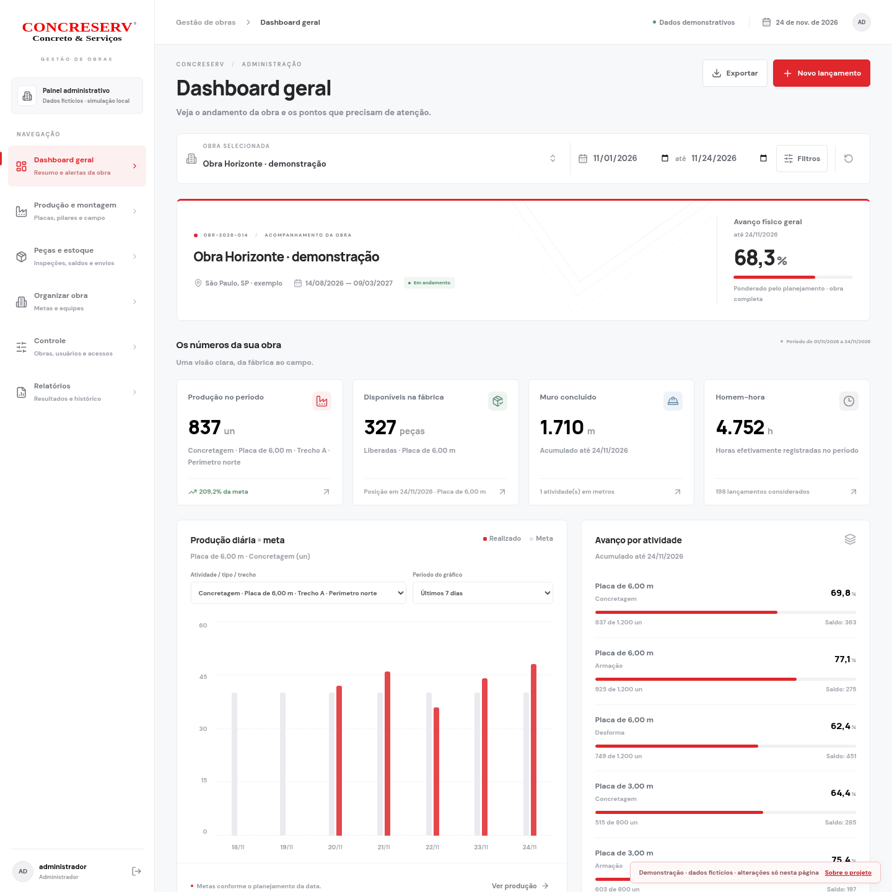
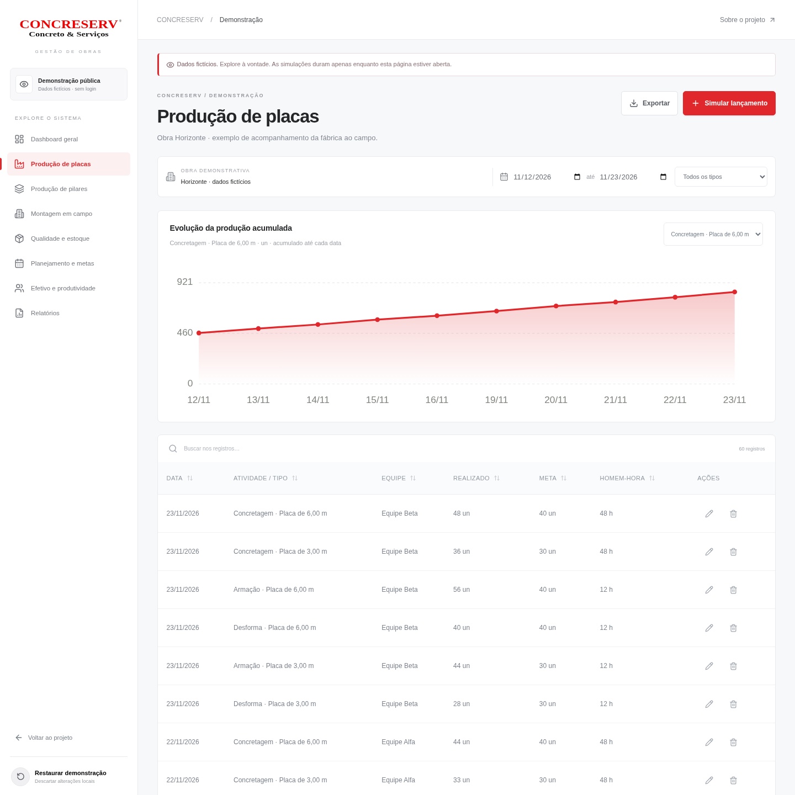

# CONCRESERV · Gestão de obras

**Estudo de caso e demonstração interativa · Portfólio de Vinícius Ferraz**

Uma aplicação web para acompanhar a fabricação de pré-moldados e a montagem em campo: planejamento, produção diária, qualidade, estoque, efetivo e produtividade.

> **Esta é uma versão pública de portfólio.** Todos os números, obras, equipes e registros da demonstração são fictícios. O pacote não contém banco operacional, contas de usuários, configurações de e-mail ou credenciais da empresa.



## Experimente

- **Apresentação pública:** https://concreserv-portfolio.vercel.app
- **Demonstração sem login:** https://concreserv-portfolio.vercel.app/demo/dashboard

A página inicial apresenta o projeto. Em `/demo/dashboard`, você pode navegar sem cadastro, filtrar consultas, comparar metas e realizado, simular lançamentos e exportar um Excel com cinco abas. As simulações ficam apenas na memória da página e são descartadas ao recarregar.

- **Perfil:** [github.com/ViniciusFerraz09](https://github.com/ViniciusFerraz09)
- **Código:** [ViniciusFerraz09/concreserv-portfolio](https://github.com/ViniciusFerraz09/concreserv-portfolio). Este repositório contém a demonstração e a apresentação pública, com histórico próprio.

## O problema e a proposta

Quantidade produzida e quantidade liberada para montagem representam etapas diferentes. O sistema organiza essas informações por obra, atividade, tipo de peça, data e equipe. Placas de 6 m e 3 m e pilares convencionais e especiais mantêm indicadores próprios; unidades distintas não são somadas como um único indicador de produção.

O objetivo é permitir comparar o planejamento com a execução e consultar os registros que explicam o resultado. Não são divulgadas métricas de impacto comercial ou resultados reais de obras neste portfólio.

## Fluxos demonstrados

| Área | O que explorar |
| --- | --- |
| Dashboard | Meta × realizado, evolução diária, avanço, alertas e detalhes por data |
| Produção | Placas e pilares, armação, concretagem e desforma |
| Campo | Escavação, instalação, fixação, grauteamento e montagem |
| Qualidade e estoque | Inspeção, aprovação, retrabalho, rejeição, liberação, envio e instalação |
| Planejamento | Meta diária, quantidade prevista, acumulado e saldo por atividade |
| Equipes | Homem-hora e produtividade por atividade |
| Relatórios | Exportação de consultas em um Excel com cinco abas |

## Interface




## Tecnologias e limites desta versão

| Camada | Sistema original | Demonstração pública |
| --- | --- | --- |
| Interface | React, TypeScript, Vite e Lucide | React, TypeScript, Vite e Lucide |
| Dados | PostgreSQL e Supabase | Dados fictícios gerados localmente |
| Acesso | Autenticação e permissões por obra | Sem login e sem acesso ao banco original |
| E-mails | Supabase Auth com SMTP Brevo | Nenhum envio de e-mail |
| Imagens | Armazenamento de anexos no sistema original | Imagens institucionais e capturas de dados fictícios |
| Publicação | Vercel | Aplicação estática em projeto separado |
| Excel | SheetJS | SheetJS, com exemplos fictícios |

A demonstração não é uma cópia completa da operação. Cadastro de contas, gestão de permissões, envio de e-mails e armazenamento de fotos não estão conectados nesta versão pública.

## Regras de produção diária

O gráfico usa a **data de execução** do lançamento, agrupa por obra e atividade e soma lançamentos do mesmo dia. Inclui dias sem produção nos períodos de 7, 15, 30 dias ou em datas personalizadas. Metas usam o histórico datado do planejamento; quando necessário, a meta registrada nos lançamentos. Ausência de informação não vira uma meta inventada.

A navegação e as tabelas se adaptam a computadores e celulares. Períodos longos e tabelas largas têm rolagem dentro do componente, com indicação acessível.

## Minha participação

**Vinícius Ferraz:** concepção do produto, levantamento das necessidades da operação, organização dos fluxos, definição e revisão da interface, acompanhamento da evolução e validação funcional.

A implementação contou com apoio de inteligência artificial na programação e nas revisões técnicas. Este portfólio explicita essa colaboração, sem atribuir autoria individual a todo o código ou apresentar a demonstração como um produto independente do sistema Concreserv.

## Executar localmente

Requer Node.js 22 ou 24 e npm.

```sh
npm ci
npm run dev
```

Abra o endereço informado pelo Vite. A apresentação está em `/` e a demonstração em `/demo/dashboard`.

```sh
npm test
npm run check:public
npm run build
npm run preview
```

Não é necessário arquivo `.env`, conta Supabase ou chave de API. O `vercel.json` inclui o redirecionamento das rotas da demonstração e cabeçalhos para a hospedagem estática.

## Estrutura

```text
src/Landing.tsx                Apresentação do estudo de caso
src/DemoApp.tsx                Navegação e simulações em memória
src/demoData.ts                Geração dos dados fictícios e leitor local
src/Dashboard.tsx              Componentes de acompanhamento
src/dailyProduction.mjs        Agrupamento e metas por data
src/DailyProductionChart.mjs   Gráfico com períodos e atualização
src/reporting.ts              Exportação Excel em cinco abas
public/screenshots/           Capturas apenas da demonstração
scripts/check-public.mjs       Checagem de padrões de dados privados
```

A aplicação pública não importa o cliente Supabase e não se conecta a serviços de autenticação. A versão de produção e seu histórico não fazem parte deste repositório.

A identidade visual Concreserv é utilizada na apresentação deste projeto. A publicação do código não concede direitos sobre a marca ou os arquivos institucionais.
